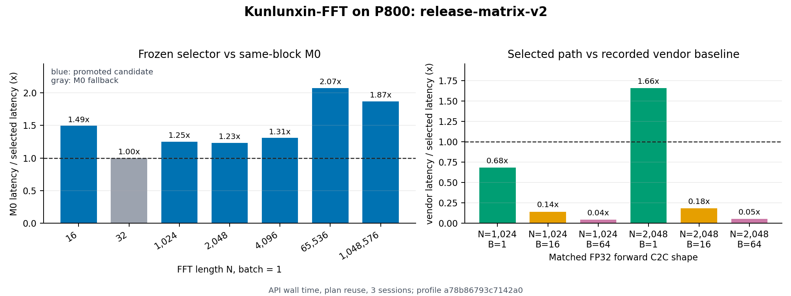

# Kunlunxin-FFT

[](LICENSE)
[](CITATION.cff)
[](https://truncat3.github.io/kunlunxin-fft/)
[](docs/reference/support.md)

**Kunlunxin-FFT 是一个面向昆仑芯平台的 FFT 算子库，也是
[cuButterfly](https://github.com/TruNcat3/cuButterfly) 混合空间-时间数据流方法的迁移实例。**
它把阶段/数据展开、局部驻留、边界组织和计算核心选择拆成可组合的设计轴，再根据硬件 profile
选择可执行实现；当前 P800 版本提供 C2C forward/inverse、R2C/C2R compatibility path、单
变换与 batch 路径、M0--M5 候选、冻结 selector 和保守 fallback。

<p align="center">
  <a href="https://www.ustc.edu.cn/">
    
  </a>
</p>

## 当前结果

> **最新状态（Issue #9 v6-1，2026-10-20/21）**：迁移验收已经闭环，但厂商级物理性能尚未
> 收敛。v6 的 140 个可比较 cell 中，current/M0 几何平均延迟比为 `0.6086x`（约降低 39%）；
> 10-cell paired closure 的中位改善约 `60.7%`，全部通过 2% guard。相同语义且厂商调用成功的
> 106 个 cell 中，cuButterfly/P800 相对 vendor 为 `4/0/102`（win/tie/loss），几何平均约
> `0.122x`。这两个比值分别回答“相对旧实现是否有迁移收益”和“是否追平厂商库”，不可混为一谈。
> [查看完整 v6-1 结果与边界](docs/benchmarks/issue9-v61.md)。

下面的图和表是较早的正式 release matrix，保留作为 M0/历史发布对照；它们不是 v6-1 的替代品。



图中左侧是冻结 selector 相对同 block M0 的加速，右侧是与当前记录的 `torch.fft.fft`
同语义点对比。正式 P800 release matrix 的结论是：

- 单变换代表点相对 M0 达到 `1.23x--2.07x`；`N=32` 和若干 batch 点由 fallback 保持约持平。
- 在六个主厂商对比点中，`N=2048, B=1` 达到 `1.66x`；其余主矩阵点仍落后。发布数据还记录了 `N=16/32, B=1` 两个小尺寸补充点。
- 全部正式发布点通过正确性检查，selected/M0 最坏相对误差为 `9.91e-7`。
- 这些数字来自单张 P800 OAM、FP32 complex64、forward C2C、API wall time、3 个独立进程
  session；不代表其他软件栈、硬件或未测语义。

Issue #6 的历史语义矩阵快照（不能与上面的 release matrix 或 v6-1 混合平均）包含 144 个
`N × B × semantic` cell 中，当前 vendor 栈支持 120 个，selector 相对 vendor 为 **7 胜、
113 负**，几何平均 speedup 为 `0.0986x`。这份结果确认 inverse/R2C/C2R 的接口、正确性和
fail-closed 选择语义已经贯通，而不是宣称这些兼容路径已经达到厂商性能。详见[语义矩阵](docs/benchmarks/results.md#issue-6-semantic-matrix-v2)。

完整逐点数据、负点和计时边界见[实验结果](docs/benchmarks/results.md)与
[测量协议](docs/benchmarks/methodology.md)。按实验目的继续阅读[C2C 性能](docs/benchmarks/c2c.md)、
[端到端口径](docs/benchmarks/end-to-end.md)和[规模切片](docs/benchmarks/scale.md)。

Issue #9 的不可变发布目录、门禁和下一轮能力核验入口见[最新 v6-1 验收页](docs/benchmarks/issue9-v61.md)。

### 最新迁移验收

Issue #3 已完成并关闭。该轮证据不改写上面的冻结 release 快照，而是验证新增 batch 核心、
性能模型和外部计算核心组合：

| 验收项 | 最新结果 | 发布边界 |
|---|---|---|
| Batch 局部核心 | `N=1024/2048, B=16/64` 相对旧 M4 incumbent 提升 `2.2x--2.7x` | M2/M5 参与比较；通过 2% guard 的 M2 local-fused 项进入冻结 selector |
| 模型筛选 | full-space holdout top-3 命中 `6/6`；top-1 regret `0.00%--0.22%`，均值 `0.0816%` | 模型只筛选候选，最终仍由实测决定 |
| 外部核心组合 | Issue #3 多进程 canary：`N=2048, B=16` 的 A1P1 为 `0.2298 ms`，vendor 为 `0.6586 ms`，即 `2.87x` | Issue #6 仅将独立确认后的 `N=2048,B=16,c2c,dit` 写入 exact-shape composition table；`N=1024` 两点仍落后 |

完整协议、稳定性和负结果见[批量与模型验证](docs/benchmarks/batch-focus.md)。四类数字必须分开
阅读：冻结 release、Issue #6 语义矩阵、已晋升的 exact-shape composition 项、未晋升的 experimental canary。

## 快速开始

需要厂商 xpytorch 环境（`torch + torch_xmlir + Triton XPU backend`）。脚本检查现有环境，
不会安装驱动或自动生成新硬件模型。

```bash
git clone https://github.com/TruNcat3/kunlunxin-fft.git
cd kunlunxin-fft

export CUDA_VISIBLE_DEVICES=6  # 改为当前可用的 P800 设备号
bash scripts/init.sh
bash scripts/build.sh
python3 scripts/smoke.py
python3 scripts/test_correctness.py --profile smoke
```

最小 plan-reuse 调用：

```python
import torch
import torch_xmlir  # 激活参考环境中的 XPU runtime
from src.xpu import DeviceProfile, execute_fft_plan, plan_fft

x = torch.randn(2048, device="cuda", dtype=torch.complex64)
profile_hash = DeviceProfile.load().hash()
plan = plan_fft("dit", 2048, profile_hash=profile_hash)
y = execute_fft_plan(plan, x)
print(plan.executed, plan.fallback, plan.reason)
```

这里的 `"cuda"` 是该 xpytorch 栈暴露 P800 的设备键，不表示代码运行在 NVIDIA GPU 上。
安装细节见[安装](docs/getting-started/installation.md)，接口语义见
[Plan 与选型](docs/user-guide/plans.md)。

## 为什么这样设计

FFT 的算术量固定，但硬件时间不只由蝶形 FLOPs 决定。纯阶段并行会反复物化阶段边界，纯数据
并行又会受局部容量和依赖链限制。cuButterfly 的核心观察是：同时在阶段维度和数据维度做空间/
时间划分，用局部驻留与边界重排降低数据搬运，再把 radix 或矩阵小 FFT 作为可替换计算核心。

Kunlunxin-FFT 保留这套方法层抽象，但所有 kernel、布局和 lowering 都针对 P800 重新实现：

```text
架构映射 A (Us, Ts, Ud, Td, layout, residence, pipeline)
        x 计算核心 P (radix-2, radix-4, dense-dot FFT64, ...)
        -> P800 lowering contract 过滤
        -> profile-bound selector
        -> 可执行 plan 或 M0 fallback
```

因此计算流优化与计算核心优化在概念上正交、在资源上耦合，并不互斥。详细推导见
[设计动机](docs/design/motivation.md)和[架构与数据流](docs/design/architecture.md)。本观点和
方法论来源于 cuButterfly；本仓库的独立内容是 P800 lowering、实现、选择器和实测证据。

### 当前完成度

| 层次 | 当前状态 |
|---|---|
| 方法抽象与合法 lowering | 已迁移并实测 M0--M5；Issue #9 v6-1 的 41/41 release gate 通过 |
| 单变换局部融合/核心选择 | 已完成首轮优化，代表点相对 M0 为 `1.23x--2.07x` |
| Batch 高效局部核心 | 已接入 matrix/radix-4/local-fused 候选；focus 点相对旧 incumbent 为 `2.2x--2.7x` |
| 硬件 profile/成本模型 | 手动 probe、环境 fail-closed、结构模型、bounded search 与 holdout 已实现；安装期一键自动化仍在路线图中 |
| 外部计算核心组合 | 已完成 materialized sub-transform canary；只有 `N=2048,B=16,c2c,dit` 进入独立 composition table，仍不是 resident kernel |
| 跨 worker persistent pipeline | 路线图中，不是当前发布路径；v6-1 未把它计入已完成能力 |

新增实现应先阅读[增加设计点](docs/development/adding-design-points.md)和[测试策略](docs/testing.md)，
再更新 selector 与发布证据。[Issue #3](https://github.com/TruNcat3/kunlunxin-fft/issues/3)
已作为本轮 batch/模型/外部核心迁移验收关闭；后续未完成项见[未来计划](docs/roadmap.md)。

## 阅读顺序

| 读者 | 建议路径 |
|---|---|
| 首次使用 | [安装](docs/getting-started/installation.md) -> [首次运行](docs/getting-started/quickstart.md) -> [支持范围](docs/reference/support.md) |
| 了解方法 | [设计动机](docs/design/motivation.md) -> [架构与数据流](docs/design/architecture.md) -> [计算核心](docs/design/kernels.md) -> [性能模型](docs/design/performance-model.md) |
| 阅读实验 | [结果汇总](docs/benchmarks/results.md) -> [测量协议](docs/benchmarks/methodology.md) -> [C2C](docs/benchmarks/c2c.md) -> [端到端](docs/benchmarks/end-to-end.md) -> [规模切片](docs/benchmarks/scale.md) |
| 复现/开发 | [数据与复现](docs/benchmarks/reproducibility.md) -> [增加设计点](docs/development/adding-design-points.md) -> [测试策略](docs/testing.md) -> [验证与发布](docs/development/validation-and-release.md) |

在线文档：<https://truncat3.github.io/kunlunxin-fft/>。

## 支持边界

当前已验证接口是 1D、二次幂长度、FP32/complex64 的 C2C forward/inverse；R2C/C2R 首轮为
复用 C2C 的 compatibility path，并不代表专用 real-FFT 核心。`norm` 与 `torch.fft` 对齐，
语义矩阵覆盖已列出的 `N=64..65536`、batch 和四种语义，但广泛 vendor 性能仍未收敛。DIT 与
DIF 是 forward FFT 的阶段组织，不是 API 方向。非二次幂、多维、其他精度、稳定 C ABI 和用户
stream 接口仍在路线图中。内部 kernel 使用 planar 实虚分离 lowering，但公开 Python 输入是
`torch.complex64` tensor。

## 引用与许可

软件采用 [Research-Only Non-Commercial License (RONC-1.0)](LICENSE)。许可证允许非商业研究、
教学、评估和个人用途下的修改与再发布，明确禁止商业使用；商业许可需另行书面授权。第三方组件
仍适用其原许可证。引用本实现和 P800 实验时请引用 Kunlunxin-FFT；引用混合空间-时间数据流方法
时请同时引用 cuButterfly。机器可读信息见 [CITATION.cff](CITATION.cff)，作者与机构信息见
[项目与作者](docs/about.md)。

```bibtex
@software{wang2026kunlunxinfft,
  author       = {Teng Wang},
  title        = {Kunlunxin-FFT: A Hardware-Mapped FFT Operator Library for Kunlunxin P800},
  year         = {2026},
  url          = {https://github.com/TruNcat3/kunlunxin-fft},
  organization = {High Efficient Intelligent Computing Lab,
                  Suzhou Institute for Advanced Research,
                  University of Science and Technology of China}
}
```