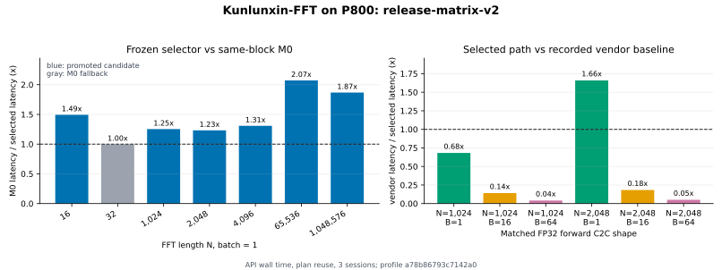

# Kunlunxin-FFT 文档

Kunlunxin-FFT 是一个面向昆仑芯平台的 FFT 算子库，也是
[cuButterfly](https://github.com/TruNcat3/cuButterfly) 混合空间-时间数据流方法在 P800 上的
迁移实例。当前版本完成了可执行设备路径、M0--M5 候选、冻结 selector、plan reuse、batch 路径、
正确性门禁和正式 release matrix。

  

    
  

  

    <strong>Teng Wang</strong> 
    High Efficient Intelligent Computing Lab 
    Suzhou Institute for Advanced Research, USTC 
    <a href="mailto:wangt635@ustc.edu.cn">wangt635@ustc.edu.cn</a>
  

## 一张图看当前结果

<figure class="doc-figure">
  
  <figcaption>正式 release matrix。左侧与同 block M0 比较；右侧为 N=1024/2048、B=1/16/64 的六个主厂商对比点。数值大于 1 表示 Kunlunxin-FFT 对应 selected path 更快。</figcaption>
</figure>

当前证据支持以下结论：

- selector 在单变换代表点相对 M0 获得 `1.23x--2.07x`；没有可靠收益时回退 M0。
- 厂商基线不是整体被超越：六个主 matched shape 中只有 `N=2048, B=1` 的 selected path 更快；`N=16/32, B=1` 另作为小尺寸补充点记录。
- 发布矩阵全部通过 NumPy complex128 参考检查；完整误差、设备和协议见[结果汇总](benchmarks/results.md)。
- 本项目证明方法能够迁移并产生可复现收益，不声称已达到 P800 的全局最优。

## 从哪里开始

| 目标 | 第一步 | 然后阅读 |
|---|---|---|
| 在 P800 上运行 | [安装与环境](getting-started/installation.md) | [首次运行](getting-started/quickstart.md)、[Plan 与选型](user-guide/plans.md) |
| 理解为什么这样设计 | [为什么混合展开](design/motivation.md) | [架构与数据流](design/architecture.md)、[计算核心](design/kernels.md) |
| 判断性能结论 | [实验设计与结果汇总](benchmarks/results.md) | [测量协议](benchmarks/methodology.md)、[消融](benchmarks/ablations.md) |
| 复现或扩展 | [原始数据与复现](benchmarks/reproducibility.md) | [工程结构](development/repository-layout.md)、[验证与发布](development/validation-and-release.md) |

## 当前接口边界

公开 Python 入口接受连续 `torch.complex64` XPU tensor，支持 1D 二次幂长度、forward C2C、
rank-1 单变换或 `(B, N)` batch。DIT/DIF 都是 forward FFT 的分解。内部 planar lowering 不是
用户输入格式。未覆盖能力见[支持范围](reference/support.md)和[未来计划](roadmap.md)。

下一页：[安装与环境](getting-started/installation.md)。
